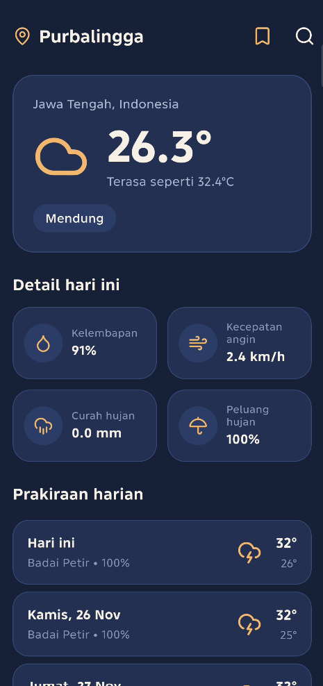
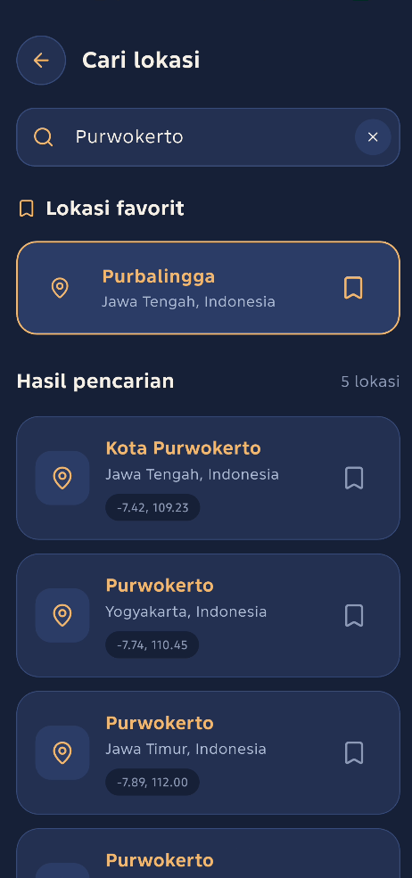
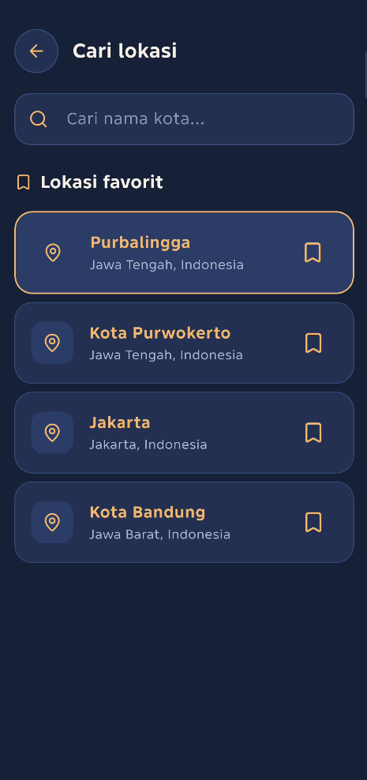
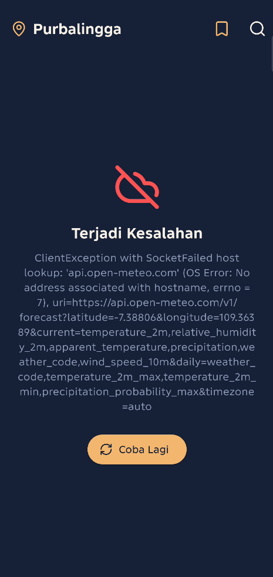

# Aplikasi Prakiraan Cuaca (Responsi Praktikum Pemrograman Mobile)

Aplikasi prakiraan cuaca berbasis **Flutter** dan **Dart** yang menyajikan informasi kondisi cuaca terkini serta prakiraan cuaca harian secara *real-time* menggunakan layanan **Open-Meteo REST API**. Aplikasi ini dirancang menggunakan pola arsitektur **Model-View-ViewModel (MVVM)** dengan antarmuka bertema gelap (*Dark Navy & Warm Amber*) berbasis **Material Design**.

---

* **Nama:** Reva Albana
* **NIM:** H1D024080
* **Shift KRS:** E
* **Shift Sekarang:** H

---

## Fitur Utama & Spesifikasi Teknis

1. **Informasi Cuaca Terkini & Prakiraan Harian (`HomeScreen`)**
   * Menampilkan nama lokasi aktif beserta wilayah/negara, kondisi cuaca terkini (konversi dari kode WMO), suhu saat ini, serta suhu yang dirasakan (*apparent temperature*).
   * Menampilkan metrik detail cuaca hari ini dalam tata letak grid responsif: **Kelembapan udara**, **Kecepatan angin**, **Curah hujan**, dan **Peluang hujan maksimum**.
   * Menampilkan daftar prakiraan cuaca beberapa hari ke depan lengkap dengan ikon cuaca, deskripsi kondisi, peluang hujan, serta suhu maksimum dan minimum harian.
   * Mendukung fitur *pull-to-refresh* untuk memperbarui data cuaca langsung dari API.

2. **Pencarian Kota & Lokasi Favorit (`SearchScreen`)**
   * Melakukan pencarian lokasi secara *real-time* ke **Open-Meteo Geocoding API** berdasarkan kata kunci nama kota yang diketik pengguna.
   * Menampilkan daftar hasil pencarian beserta nama kota, provinsi/wilayah, negara, dan koordinat geografis (`latitude`, `longitude`).
   * Pengguna dapat menyimpan atau menghapus kota ke daftar **Lokasi Favorit** secara permanen menggunakan penyimpanan lokal (`SharedPreferences`), sehingga data tetap tersedia saat aplikasi ditutup dan dibuka kembali.

3. **Penanganan Kondisi State Jaringan**
   * Menangani seluruh siklus permintaan data jaringan secara eksplisit: **Loading** (indikator pemuatan), **Loaded** (data tampil normal), **Empty** (hasil pencarian atau daftar favorit kosong), dan **Error** (pesan informatif disertai tombol *Coba Lagi* saat koneksi terputus atau permintaan gagal).

---

## Struktur Folder Aplikasi

Struktur kode di dalam direktori `lib/` dipisahkan secara modular sesuai prinsip *separation of concerns* pada pola arsitektur **MVVM**:

```text
lib/
├── main.dart                         # Entry point aplikasi & inisialisasi Provider
├── models/                           # Layer Model (Representasi & parsing data JSON)
│   ├── location_model.dart           # Model data lokasi hasil Geocoding & penyimpanan lokal
│   ├── weather_model.dart            # Model data CurrentWeather, DailyForecast, & WeatherResponse
│   └── weather_code_mapper.dart      # Pemetaan kode cuaca WMO ke deskripsi Indonesia & Lucide Icons
├── services/                         # Layer Service (Sumber data eksternal & lokal)
│   ├── weather_service.dart          # HTTP GET request ke Open-Meteo Geocoding & Forecast API
│   └── storage_service.dart          # Persistensi data lokasi favorit & lokasi terakhir (SharedPreferences)
├── viewmodels/                       # Layer ViewModel (Pengelolaan state & logika presentasi)
│   └── weather_viewmodel.dart        # ChangeNotifier penghubung antara Service dan View
├── views/                            # Layer View (Halaman utama aplikasi)
│   ├── home_screen.dart              # Layar informasi cuaca utama & prakiraan harian
│   └── search_screen.dart            # Layar pencarian lokasi & pengelolaan kota favorit
├── widgets/                          # Komponen UI modular yang digunakan ulang
│   ├── current_weather_card.dart     # Kartu ringkasan suhu & kondisi cuaca terkini
│   ├── weather_metrics_grid.dart     # Grid 2x2 detail metrik cuaca hari ini
│   └── daily_forecast_tile.dart      # Kartu item prakiraan cuaca harian
└── theme/                            # Konfigurasi tema & tipografi aplikasi
    └── app_theme.dart                # Tema konsisten Dark Navy (#172036) & Warm Amber (#F2B66D)
```

---

## Penerapan Arsitektur MVVM

Aplikasi ini menerapkan pola **Model-View-ViewModel (MVVM)** untuk menjaga pemisahan yang tegas antara logika bisnis, akses data, dan tampilan antarmuka:

1. **Model (`lib/models/`)**
   * Bertanggung jawab mendefinisikan struktur data aplikasi (`LocationModel`, `CurrentWeather`, `DailyForecast`, `WeatherResponse`) serta menyediakan metode serialisasi `fromJson()` dan `toJson()`.
   * Seluruh data cuaca murni dipetakan dari respons JSON REST API tanpa data statis (*hardcoded*).

2. **Service (`lib/services/`)**
   * `WeatherService` menangani komunikasi jaringan menggunakan *package* `http` dengan metode `GET`.
   * `StorageService` menangani penyimpanan lokal menggunakan `SharedPreferences` untuk menyimpan daftar lokasi favorit serta lokasi terakhir yang dipilih pengguna.

3. **ViewModel (`lib/viewmodels/weather_viewmodel.dart`)**
   * Mengimplementasikan `ChangeNotifier` dari *package* `provider`.
   * Menjadi satu-satunya perantara antara `Service` dan `View`. ViewModel menyimpan *state* aplikasi (`selectedLocation`, `weatherData`, `searchResults`, `favoriteLocations`, status `isLoading`, serta pesan `error`), lalu memanggil `notifyListeners()` setiap kali terjadi perubahan data.

4. **View (`lib/views/` & `lib/widgets/`)**
   * Terdiri dari kombinasi `StatelessWidget` dan `StatefulWidget` yang murni bertugas merender antarmuka dan menangkap interaksi pengguna.
   * View mendengarkan perubahan *state* dari `WeatherViewModel` melalui `Consumer` / `Provider.of` dan memperbarui tampilan secara reaktif tanpa menyentuh logika pemanggilan API secara langsung.

---

## Implementasi Open-Meteo REST API

Aplikasi terintegrasi dengan dua *endpoint* resmi dari **Open-Meteo** menggunakan metode HTTP **`GET`**:

### 1. Geocoding API (Pencarian Kota)
Digunakan pada fitur pencarian lokasi untuk memperoleh koordinat lintang dan bujur berdasarkan nama kota:
```http
GET https://geocoding-api.open-meteo.com/v1/search?name={query}&count=10&language=id&format=json
```

### 2. Weather Forecast API (Data Cuaca Terkini & Harian)
Digunakan untuk mengambil data cuaca berdasarkan koordinat lokasi terpilih dengan zona waktu otomatis (`timezone=auto`):
```http
GET https://api.open-meteo.com/v1/forecast?latitude={latitude}&longitude={longitude}&current=temperature_2m,relative_humidity_2m,apparent_temperature,precipitation,weather_code,wind_speed_10m&daily=weather_code,temperature_2m_max,temperature_2m_min,precipitation_probability_max&timezone=auto
```

### Pemetaan Parameter Data API ke Antarmuka

| Kategori | Parameter API Open-Meteo | Keterangan Data yang Ditampilkan |
| :--- | :--- | :--- |
| **Koordinat & Waktu** | `latitude`, `longitude`, `timezone=auto` | Parameter kueri lokasi dan penyesuaian zona waktu lokal |
| **Cuaca Terkini** | `current.temperature_2m` | Suhu udara saat ini ($^\circ\text{C}$) |
| **Cuaca Terkini** | `current.apparent_temperature` | Suhu yang dirasakan tubuh ($^\circ\text{C}$) |
| **Cuaca Terkini** | `current.relative_humidity_2m` | Kelembapan udara relatif ($\%$) |
| **Cuaca Terkini** | `current.precipitation` | Volume curah hujan ($\text{mm}$) |
| **Cuaca Terkini** | `current.wind_speed_10m` | Kecepatan angin ($\text{km/h}$) |
| **Cuaca Terkini** | `current.weather_code` | Kode kondisi cuaca WMO (ikon & deskripsi cuaca) |
| **Prakiraan Harian** | `daily.temperature_2m_max` | Suhu maksimum harian ($^\circ\text{C}$) |
| **Prakiraan Harian** | `daily.temperature_2m_min` | Suhu minimum harian ($^\circ\text{C}$) |
| **Prakiraan Harian** | `daily.precipitation_probability_max` | Peluang hujan maksimum harian ($\%$) |

---

## Library / Dependencies yang Digunakan

* [`http`](https://pub.dev/packages/http) — Melakukan permintaan HTTP `GET` ke REST API Open-Meteo.
* [`provider`](https://pub.dev/packages/provider) — Manajemen *state* reaktif berbasis `ChangeNotifier` untuk pola arsitektur MVVM.
* [`shared_preferences`](https://pub.dev/packages/shared_preferences) — Penyimpanan lokal persisten untuk daftar lokasi favorit dan lokasi terakhir.
* [`intl`](https://pub.dev/packages/intl) — Pemformatan tanggal prakiraan harian ke dalam Bahasa Indonesia.
* [`lucide_icons_flutter`](https://pub.dev/packages/lucide_icons_flutter) — Set ikon vektor untuk indikator cuaca dan navigasi antarmuka.

---

## Cara Menjalankan Proyek

1. Pastikan **Flutter SDK** sudah terpasang pada perangkat kamu.
2. *Clone* repositori ini:
   ```bash
   git clone https://github.com/RevaAlbana/Responsi2-Mobile-H1D024080.git
   cd Responsi2-Mobile-H1D024080
   ```
3. Unduh seluruh *dependencies*:
   ```bash
   flutter pub get
   ```
4. Jalankan aplikasi pada emulator Android atau perangkat fisik:
   ```bash
   flutter run
   ```

---

## Screenshot Aplikasi

| Home / Weather Screen | Search / Location Screen |
| :---: | :---: |
|  |  |

| Lokasi Favorit Tersimpan | Kondisi Error / Jaringan Terputus |
| :---: | :---: |
|  |  |
